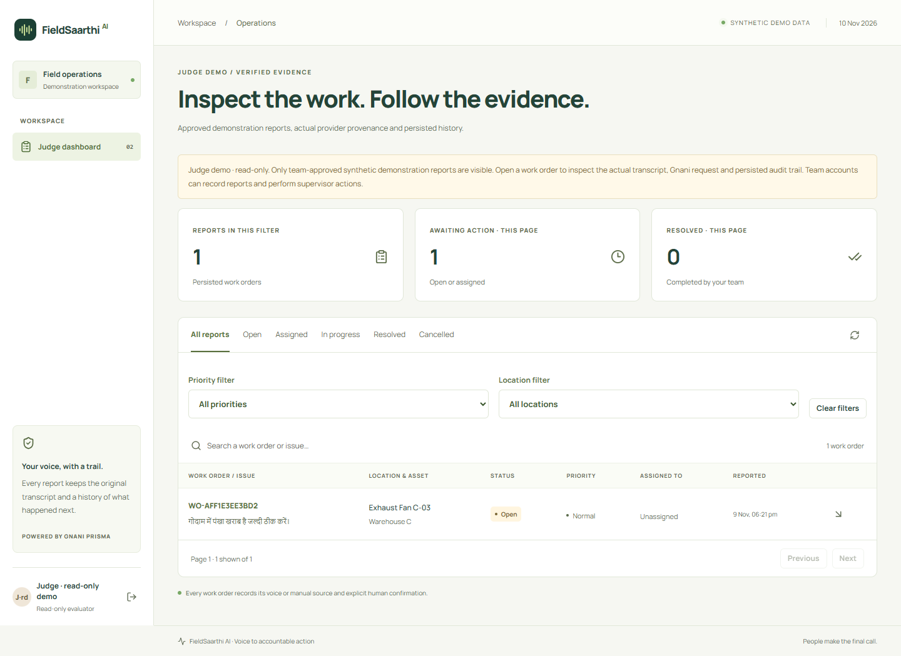
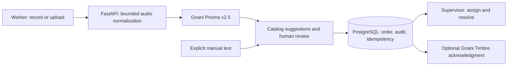

# FieldSaarthi AI

Turn a spoken maintenance report into a human-verified work order that a supervisor can assign, resolve and audit.

---

[Live demo](https://fieldsaarthi-ai.onrender.com) · [Demo credentials](#demo-access) · [Overview](#-overview) · [Getting started](#-getting-started) · [Usage](#-usage) · [Architecture](#-architecture) · [Contributing and support](#-contributing-and-support) · [License and credits](#-license-and-credits)

##  Overview



Maintenance faults often arrive as informal voice messages with missing equipment details and no clear owner. FieldSaarthi connects speech recognition to a reviewed, persistent workflow for **facility workers, supervisors and maintenance coordinators**.

- **Genuine speech recognition:** Backend-only Gnani **Prisma v2.5** requests return the original transcript, model and request ID. The deployed application has no mock speech-success path.
- **Human verification:** Catalog-backed location, equipment, issue and urgency suggestions include evidence. Missing or ambiguous details require correction and explicit confirmation.
- **Durable work orders:** PostgreSQL transactions, idempotency and a unique intake relationship prevent duplicate creation. Original provider facts and audit events are protected against modification.
- **Supervisor operations:** Filter/search the queue, assign workers, adjust priority and move reports through controlled, version-checked states.
- **Accessible alternatives:** A separate `MANUAL_TEXT` path supports typed reports without claiming Gnani speech provenance. The interface supports responsive layouts and keyboard navigation.
- **Optional spoken feedback:** Gnani **Timbre v2.5** acknowledgment runs after a work order is saved; audio failure cannot undo it.

### Demo access

Open **https://fieldsaarthi-ai.onrender.com**. For the fastest inspection, select **Open judge demo**: **no email or password is required**. This read-only session exposes only the approved report **WO-AFF1E3EE3BD2** and cannot call billable speech endpoints.

For an interactive walkthrough, enter one of these **shared synthetic demo accounts** in the email/password form:

| Role | Email | Password | Access |
| --- | --- | --- | --- |
| Worker — Asha | `worker@fieldsaarthi.demo` | `hMaKHjkyOTmViR51kXKP` | Create reports and view this account’s reports |
| Worker — Ravi | `worker2@fieldsaarthi.demo` | `I35Qf-__dDmaKgIaFiJm` | Create reports and view this account’s reports |
| Supervisor — Meera | `supervisor@fieldsaarthi.demo` | `SOCNiUgz4CwnCzbGdlUg` | View the demo queue; assign, prioritize and resolve reports |

These credentials are intentionally public for this temporary hosted demo. Workers can create reports; the supervisor can change demo workflow state. Use synthetic fault descriptions and consenting audio only. Shared-account activity is visible to other users of the same account; supervisor access includes the synthetic demo queue. Live transcription and acknowledgment consume the shared Gnani credits. Local installations generate their own credentials and do not inherit these hosted passwords.

A free-host cold start may delay the first request. Leave the page open and retry once after it wakes. See the [judge walkthrough](docs/judge-guide.md).

### Verified release and limits

| Check | Recorded result | Evidence |
| --- | --- | --- |
| Backend regression suite | **199 passing tests**, plus strict backend/frontend checks | [Engineering release](docs/evidence/demo-operational-release.json) |
| Genuine 15-recording development evaluation | **12/15 automatic complete cases**; all **6 safety cases blocked** | [Measured evaluation](docs/evidence/audio-evaluation.json) |
| Explicit correction recovery | **3/3 saved ASR failures recovered** in isolated test replay; automatic score remains 12/15 | [Correction evidence](docs/evidence/asr-correction-recovery.json) |
| Hosted workflow reliability | **10 consecutive genuine voice-to-resolved workflows** using one repeated consenting clip | [Hosted reliability](docs/evidence/hosted/reliability.json) |
| Application rollback and restoration | All **12 baseline report details**, audits, provider facts and judge visibility preserved | [Rollback/release proof](docs/evidence/demo-operational-release.json) |
| Technical release snapshot | `demo-verified-2026-11-10`, application `85e1a5e` | [Engineering tag](https://github.com/rdx644/FieldSarthi-AI/tree/demo-verified-2026-11-10) |

These are scoped demo measurements, not a held-out accuracy benchmark or availability guarantee. Evaluated speech covers **Hindi, English and Hinglish**; Tamil is excluded from acceptance and remains unverified. Parser rules were refined on the same development corpus. The free PostgreSQL database expires **December 9, 2026**; backups and expiry are managed by the project owner for this temporary demo.

##  Getting started

### Prerequisites

| Component | Reference toolchain / requirement |
| --- | --- |
| Python | **3.12** in CI/Docker; backend manifest declares **>=3.11** |
| Node.js / npm | **Node 26** in CI/Docker; locked Vite declares `^20.19.0 || >=22.12.0` |
| PostgreSQL | **18** verified locally and in deployment |
| uv | **0.11.1** used in CI/Docker |
| Gnani access | A valid server-side API key for genuine STT; Timbre access for optional TTS |
| Browser | Microphone permission and HTTPS, or localhost for development |

The commands below use **PowerShell**. On macOS/Linux, use the same relative directories and commands, replacing `Copy-Item .env.example .env` with `cp .env.example .env`, and `npm.cmd` with `npm`.

```powershell
git clone https://github.com/rdx644/FieldSarthi-AI.git
cd FieldSarthi-AI
Copy-Item .env.example .env
```

### Database and configuration

For a **fresh database setup**, open PostgreSQL’s SQL shell with `psql -U postgres`, then create an application owner and separate application/test databases:

```sql
CREATE ROLE fieldsaarthi LOGIN PASSWORD 'replace_with_a_local_password';
CREATE DATABASE fieldsaarthi OWNER fieldsaarthi;
CREATE DATABASE fieldsaarthi_test OWNER fieldsaarthi;
```

Skip creation when reusing existing databases. Edit the private root `.env` with your actual connection settings and random secrets before starting the backend. PostgreSQL commonly uses port `5432`; this project’s existing isolated Windows cluster uses **55432**, as shown in `.env.example`. Match the host, port, database and password to your installation.

| Variable | Purpose | Required / default |
| --- | --- | --- |
| `DATABASE_URL` | Backend PostgreSQL application connection | Required; use your own credentials |
| `TEST_DATABASE_URL` | Separate PostgreSQL test connection | Required for tests; database must be `fieldsaarthi_test` |
| `JWT_SECRET` | Backend session signing | Required; random secret of at least 32 characters |
| `GNANI_API_KEY_ID` | Server-side Gnani authentication | Required; use `your_api_key_here` only as a placeholder |
| `APP_ENV` | Cookie and seed behavior | `development` locally; `production` on the host |
| `CORS_ORIGINS` | Allowed frontend origins | Local example includes localhost/127.0.0.1 port 5173 |
| `GNANI_REQUESTS_ENABLED` | Operator pause for both STT and TTS | `true`; set `false` to pause paid speech calls |
| `GNANI_TTS_ENABLED` | Optional saved-ticket acknowledgment | `false` locally; enabled in the hosted demo |
| `PUBLIC_JUDGE_DEMO_ENABLED` | Restricted password-free judge access | `false` locally; enabled on the host |
| `DEMO_WORKER_PASSWORD` / `DEMO_WORKER2_PASSWORD` / `DEMO_SUPERVISOR_PASSWORD` | Initial seeded-account passwords | Optional in development; required in production, at least 12 characters |

`GNANI_STT_MODEL` and `GNANI_STT_URL` also appear in the example file; the current adapter fixes its model/endpoint in code rather than reading overrides. No Gnani credential belongs in a frontend environment variable.

### Install, build and start

Starting from the repository root after configuring `.env`:

```powershell
cd web
npm.cmd ci --ignore-scripts
npm.cmd run build
cd ../api
uv sync --locked --python 3.12
uv run alembic upgrade head
uv run python -m app.seed
uv run uvicorn app.main:app --host 127.0.0.1 --port 8000 --no-access-log
```

Open **http://127.0.0.1:8000**. FastAPI serves the built frontend and API from one origin. On a fresh development seed, login details are written to ignored `private/demo-accounts.json`; repeat seeding preserves existing passwords. Migrations are required; startup does not silently invent tables.

For separate frontend development, keep the backend running at port 8000 and open a **second terminal**, starting from the repository root:

```powershell
cd web
npm.cmd run dev
```

Open the URL Vite prints, normally **http://127.0.0.1:5173**. Vite proxies `/api` and `/health` to the backend; no separate frontend API-base variable is needed.

## Usage

1. **Sign in:** Use a hosted demo worker account or your locally seeded account. Choose the password-free judge option for inspection only.
2. **Describe a fault:** Record a short consenting report or choose **Upload audio instead**, select the language and choose **Transcribe report**. A useful synthetic example is “Block B second floor ka water pump leak ho raha hai, urgent hai.” Recording targets 25 seconds; the backend rejects decoded audio over 30 seconds or uploads above 10 MiB.
3. **Review the result:** Inspect the original transcript and actual provider provenance. Correct the transcript and separately check location, equipment, issue, urgency and description: editing transcript text does **not** automatically update those fields.
4. **Confirm once:** Explicitly confirm the reviewed details to create a work order. Refresh to inspect its server-returned code and persisted state. Typed reports use the distinct manual path.
5. **Manage the report:** Sign out and use the supervisor account to find the new report, assign a worker, start work and resolve it. Keep the approved judge example unchanged; use a newly created synthetic report for this walkthrough.
6. **Play acknowledgment:** Where enabled, request optional Timbre playback from a saved ticket. If audio is paused or unavailable, the work order remains saved.

The shared speech admission limits are **24 operations per user/hour** and **80 per process/hour** across STT and TTS. Counters reset on restart, and adapter retries may add upstream attempts; these are not monetary caps. The operator monitors the actual Gnani console balance. Pausing with `GNANI_REQUESTS_ENABLED=false` leaves saved workflows and manual reporting available; a Render environment change needs a deploy to take effect.

##  Architecture



Gnani supplies speech recognition; the application owns catalog extraction and workflow decisions. PostgreSQL is authoritative. Row/advisory locks, unique constraints, expected versions and immutable audit/provenance boundaries protect business state. Timbre is isolated from the order-creation transaction.

```text
api/
  app/          # Typed FastAPI routes, adapters, services and persistence
  alembic/      # Versioned schema migrations
  scripts/      # Startup, evaluation and operational tools
  tests/        # Unit, contract, PostgreSQL integration and browser checks
web/
  src/pages/    # Recording, manual review, queue and detail UI
  src/lib/      # Typed API access and navigation
  public/       # Browser assets
docs/          # Architecture, ADRs, traceability and sanitized evidence
tasks/         # Execution and handoff status
```

[Architecture and trust boundaries](docs/architecture.md) · [ADRs](docs/adrs/) · [API schema](https://fieldsaarthi-ai.onrender.com/docs) · [Deployment](docs/deployment.md) · [Operations](docs/operations.md) · [Complete future-change context](docs/final-project-context.md)

### Deployment and privacy

The canonical [render.yaml](render.yaml) defines the free Docker web service and PostgreSQL 18 database. Automatic deployments are off; verified application commits are deployed deliberately. The container builds the frontend, applies migrations and seeds before serving with one worker. Keep Gnani, database and JWT secrets in the host secret manager. The published demo passwords above are the sole intentional credential-publication exception.

Audio is decoded in bounded temporary storage rather than retained as an application attachment. Use synthetic data and consenting recordings; routine logs omit transcript/audio bodies and credentials. Private graph exports, original roadmap/submission drafts, raw audio and runtime secrets remain excluded from the current tracked repository. Participant contribution descriptions, final video/post and the official form remain participant-owned.

##  Contributing and support

- **Report an issue:** Use the [issue tracker](https://github.com/rdx644/FieldSarthi-AI/issues) with reproducible steps, expected/actual behavior and sanitized request IDs. Include FR/NFR/WBS references where applicable; omit passwords, tokens, raw audio and personal data.
- **Prepare a change:** Read [AGENTS.md](AGENTS.md), [requirements](docs/rtm.md), [current tasks](tasks/todo.md) and [project context](docs/final-project-context.md). Preserve user work, provider provenance, schema invariants and intentional privacy exclusions.
- **Validate:** Run the relevant checks below and explain their scope in a focused PR. Protected `main` requires the quality gate; do not weaken it.

From `api/`, with a separate configured test database:

```powershell
uv run ruff check .
uv run ruff format --check .
uv run mypy app
uv run pytest -q
uv run pip-audit
uv run python scripts/repository_guard.py
```

From `web/`:

```powershell
npm.cmd run lint
npm.cmd run format:check
npm.cmd run build
npm.cmd audit --audit-level=high
```

For the full **test-only-provider** browser/accessibility workflow, build the frontend, install Chromium and run from `api/`:

```powershell
uv run playwright install chromium
uv run python tests/browser/workflow_check.py --channel chromium
```

Integration fixtures and this browser workflow deliberately recreate **only the `fieldsaarthi_test` schema**. Run them sequentially and never point `TEST_DATABASE_URL` at application data. The ordinary automated suite makes no billable provider calls. Live STT/TTS verification is separate, explicitly credit-consuming work; do not rerun it merely for reassurance.

##  License and credits

No project `LICENSE` file is currently tracked. Licensing and reuse permissions are **not specified**; do not assume an MIT or Apache license from repository visibility. Third-party dependencies retain their respective licenses.

Created by **Shubham Putitundi and Shambhavi Kumar** for the Gnani AI internship challenge, with AI-assisted implementation and testing. Individual contribution descriptions are decided by the participants. Gnani Prisma provides speech-to-text, and optional Gnani Timbre provides spoken acknowledgment; catalog mapping, validation, persistence and supervisor workflow are application responsibilities.
