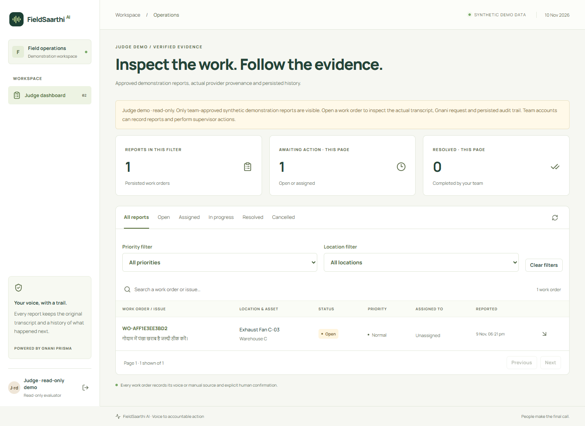
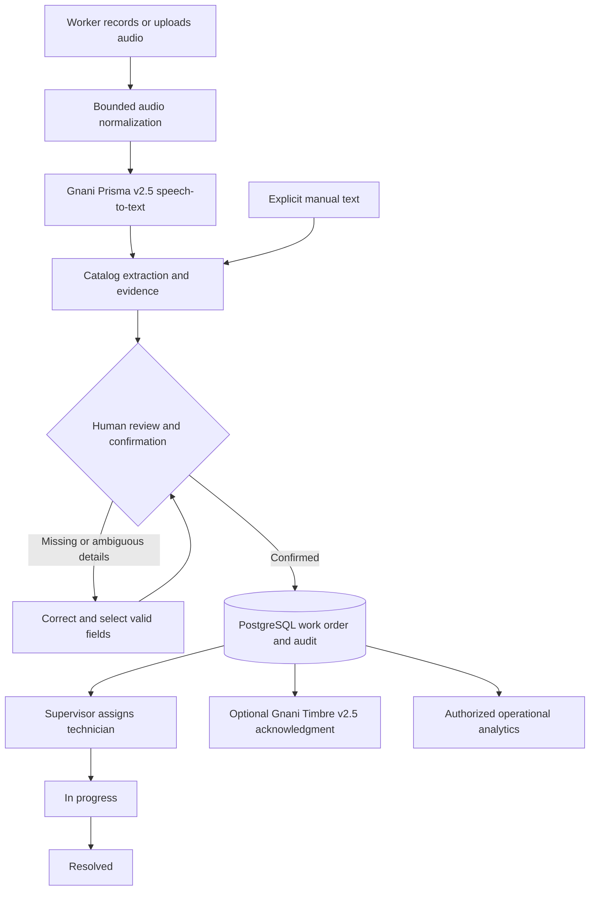

# FieldSaarthi AI

**Speak. Verify. Act.** — Multilingual voice-to-action intelligence for maintenance operations.

Built for the [Great Indian AI Internship Challenge 2026](https://www.gnani.ai/internship).

[](https://fieldsaarthi-ai.onrender.com/) [](https://www.gnani.ai/) [](https://github.com/rdx644/FieldSarthi-AI/actions)

[Live application](https://fieldsaarthi-ai.onrender.com/) · [Solution pitch](#solution-pitch) · [Reviewer walkthrough](#reviewer-walkthrough) · [Demo access](#demo-access) · [Architecture](#architecture) · [Evaluation](#evaluation-and-release-evidence) · [Local setup](#getting-started)

<!-- Before submission, participants may add the actual published video and nominated public LinkedIn/X post URLs here. Do not use placeholder links in the rendered README. -->

## Overview

Maintenance faults are frequently reported through informal calls and voice messages, leaving supervisors with incomplete information, delayed assignments and limited accountability. FieldSaarthi AI turns these reports into structured, human-verified work orders that can be assigned, tracked, resolved and audited.

Designed for **frontline facility workers, maintenance supervisors and operations coordinators**, the application combines authentic Gnani speech recognition with deterministic catalog matching, explicit human confirmation and durable business workflows. It does not merely transcribe audio; it enables a controlled operational action.



*Recorded hosted screenshot. The current release adds database-backed queue analytics; see the latest release evidence below.*

## Solution pitch

FieldSaarthi AI connects a field worker's voice report to a much accountable maintenance workflow. Gnani Prisma transcribes the report; the worker reviews catalog-backed equipment, location and issue details before explicitly confirming a durable work order. A supervisor assigns an owner, sets priority and tracks resolution. Original transcripts, corrections and workflow history remain traceable, while optional Gnani Timbre provides a spoken acknowledgment after saving.

## Key capabilities

| Capability | What the application does |
| --- | --- |
| Multilingual voice intake | Records or uploads short audio and sends it to Gnani Prisma v2.5. Hindi, English and Hinglish were evaluated in development. |
| Evidence-backed extraction | Suggests location, asset, issue and urgency using the application catalog and conservative deterministic rules. |
| Human verification | Requires review and explicit confirmation; ambiguous and missing fields must be resolved. Original provider output is retained. |
| Persistent work orders | Saves verified reports and audit events atomically, with idempotency and duplicate protection. |
| Supervisor workflow | Search and filter the queue, assign technicians, change operational priority, start work and resolve reports through version-checked transitions. |
| Operational analytics | Server-backed, role-scoped counts, issue categories, intake sources and mean resolution duration; independent of pagination and filters. |
| Optional speech feedback | Gnani Timbre v2.5 provides a spoken acknowledgment after a saved work order is requested by an authorized user. |
| Manual alternative | Typed reports are explicitly recorded as `MANUAL_TEXT`, never as a genuine Gnani transcript. |
| Public reviewer access | Password-free, read-only access to a participant-approved synthetic report, without billable speech access. |

## Reviewer walkthrough

1. Open the [live application](https://fieldsaarthi-ai.onrender.com/) and select **Open judge demo**. The free host may need to wake up.
2. Inspect the approved report `WO-AFF1E3EE3BD2`: original Prisma transcript, returned model/request ID, language and confirmed fields.
3. Compare extraction evidence with human-confirmed details and the immutable audit timeline.
4. Review the role-scoped queue metrics. The approved example is `OPEN`; it is not evidence of a completed resolution.
5. For the complete voice-to-resolution lifecycle, see the [historical hosted workflow evidence](docs/evidence/hosted/README.md) and [judge guide](docs/judge-guide.md).

The restricted judge inspection is not a substitute for the participant's public video demonstration. Use a new synthetic report and the interactive roles below if demonstrating actual speech and workflow mutations.

## Demo access

Open **https://fieldsaarthi-ai.onrender.com**. For the fastest inspection, select **Open judge demo**: **no email or password is required**. This read-only session exposes only the approved report **WO-AFF1E3EE3BD2** and cannot call billable speech endpoints.

For an interactive walkthrough, enter one of these **shared synthetic demo accounts** in the email/password form:

| Role | Email | Password | Access |
| --- | --- | --- | --- |
| Worker — Asha | `worker@fieldsaarthi.demo` | `hMaKHjkyOTmViR51kXKP` | Create reports and view this account’s reports |
| Worker — Ravi | `worker2@fieldsaarthi.demo` | `I35Qf-__dDmaKgIaFiJm` | Create reports and view this account’s reports |
| Supervisor — Meera | `supervisor@fieldsaarthi.demo` | `SOCNiUgz4CwnCzbGdlUg` | View the demo queue; assign, prioritize and resolve reports |

These credentials are intentionally public for this temporary hosted demo. Workers can create reports; the supervisor can change demo workflow state. Use synthetic fault descriptions and consenting audio only. Shared-account activity is visible to other users of the same account; supervisor access includes the synthetic demo queue. Live transcription and acknowledgment consume the shared Gnani credits. Local installations generate their own credentials and do not inherit these hosted passwords.

A free-host cold start may delay the first request. Leave the page open and retry once after it wakes. See the [judge walkthrough](docs/judge-guide.md).

## End-to-end workflow



## Genuine Gnani AI integration

| Model | Responsibility | Integration boundary |
| --- | --- | --- |
| **Prisma v2.5** | Speech-to-text (STT) | Backend sends normalized audio to Gnani and retains the original returned transcript, model and request identifier. |
| **Timbre v2.5** | Text-to-speech (TTS) | Optional saved-order acknowledgment; requested model and actual returned metadata are distinguished. |

Gnani provides voice intelligence. FieldSaarthi owns catalog extraction, verification, authorization, persistence, analytics and workflow decisions. No LLM makes maintenance decisions, and the deployed speech adapter has no mock-success path. Missing provider facts are not invented. Editing a transcript preserves its original provider text and extraction evidence.

## Latest engineering improvements

The improvements merged through [PR #18](https://github.com/rdx644/FieldSarthi-AI/pull/18) and were subsequently deployed to Render. The latest recorded release (November 15, 2026) is **application `241a063`, database migration head `0005`**.

| Change | Delivered capability |
| --- | --- |
| IMP-00 — Distribution safety | Repository/archive guards detect unsafe private exports and prevent accidental inclusion of sensitive workspace artifacts. |
| IMP-01 — Reviewer experience | Restricted judge access, clearer inspection guidance and evidence links. |
| IMP-02 — Accurate analytics | PostgreSQL aggregates over the role-accessible dataset, independent of search, filters or pagination. |
| IMP-03 — Verification | Conservative extraction, ambiguity handling and improved review guidance while preserving original provider evidence. |
| IMP-04A — Offline evaluation | WER/CER scoring and corpus-validation infrastructure; no new genuine accuracy measurement claimed. |
| IMP-05 — Provider controls | Durable, atomic PostgreSQL admission ledger for combined STT/TTS operations. |
| IMP-06 — Release assurance | Automated checks, container rehearsal, compatibility staging, additive migration and actual hosted rollback/restoration. |
| IMP-04B — Independent speech evaluation | Deferred by participants; held-out accuracy and genuine WER/CER remain unmeasured. |

[Source completion evidence](docs/evidence/improvement-source-finalisation.json) · [Hosted release evidence](docs/evidence/improvement-hosted-release.json) · [Improvement traceability](tasks/improvements.md) · [Engineering handoff](docs/HANDOFF.md)

## Evaluation and release evidence

### Latest verified engineering release — November 15, 2026

| Check | Recorded result | Evidence |
| --- | --- | --- |
| Backend regression suite | **328 passing tests**; strict static/build checks and dependency audits pass | [Source completion](docs/evidence/improvement-source-finalisation.json) |
| Chromium fixture verification | **18 accessibility/layout views** | [CI browser evidence](docs/evidence/improvement-source-ci-browser.json) |
| Actual hosted views | **6 views** at 320, 768 and 1440 px; zero recorded JavaScript errors or accessibility violations in those checks | [Browser verification](docs/evidence/hosted-improvements/browser-verification.json) |
| Improvement test traceability | **33/34 verified**; one independent audio evaluation deferred | [Hosted evidence](docs/evidence/improvement-hosted-release.json) |
| Container release rehearsal | Activation, rollback and restoration passed | [CI container evidence](docs/evidence/improvement-source-ci-container.json) |
| Actual Render release | Compatibility staging, migration `0004` → `0005`, rollback and restoration verified | [Hosted release](docs/evidence/improvement-hosted-release.json) |
| Existing data integrity | **14/14 saved reports**, audit/provider facts and protected judge visibility preserved | [Hosted release](docs/evidence/improvement-hosted-release.json) |
| Hosted analytics | Role-scoped totals reconcile and remain invariant under pagination/filters | [Hosted release](docs/evidence/improvement-hosted-release.json) |

The owner confirmed a current restore-ready backup and Gnani balance. Speech capability was restored after rehearsal. The release rehearsal performed **zero paid speech calls and zero production domain writes**. Schema verification used the deployed source and database-backed readiness contract, not direct external SQL inspection. Automatic deployment remains disabled.

### Historical genuine speech and workflow measurements — November 10 release

The following results retain their original scope; they are not a fresh independent benchmark of the November 15 release.

| Metric | Recorded result | Evidence |
| --- | --- | --- |
| Genuine audio development corpus | 15 recordings | [Audio evaluation](docs/evidence/audio-evaluation.json) |
| Nonempty transcription coverage | **14/15**; not word recognition accuracy | [Audio evaluation](docs/evidence/audio-evaluation.json) |
| Automatic complete cases | **12/15 (80%)**; not ASR accuracy | [Audio evaluation](docs/evidence/audio-evaluation.json) |
| Expected safety cases blocked | **6/6** | [Audio evaluation](docs/evidence/audio-evaluation.json) |
| Correction recovery | **3/3** in isolated replay; automatic score remains 12/15 | [Correction evidence](docs/evidence/asr-correction-recovery.json) |
| Hosted voice-to-resolution reliability | **10 consecutive workflows** using one repeated consenting clip | [Hosted reliability](docs/evidence/hosted/reliability.json) |
| Historical regression / rollback | 199 passing tests; 12 baseline reports preserved | [Historical release](docs/evidence/demo-operational-release.json) |

Historical release: [`demo-verified-2026-11-10`](https://github.com/rdx644/FieldSarthi-AI/tree/demo-verified-2026-11-10), application `85e1a5e`.

### Evaluation limitations

- Hindi, English and Hinglish were evaluated on a development corpus; parser rules were refined using that same corpus. Tamil is not acceptance-validated.
- Genuine Word Error Rate (WER), Character Error Rate (CER) and independent held-out accuracy have not been measured. Offline scoring infrastructure is available for future evaluation: [evaluation methodology](docs/tests/offline-asr-methodology.md).
- Repeated-clip reliability is not evidence of generalization to different speakers, noise conditions or accents.
- Fixture and hosted browser checks have bounded coverage; they do not establish universal accessibility or uptime.
- The application is a validated challenge prototype, not a certified enterprise production service.
- The free database's recorded expiry is December 9, 2026. Backup retention, credit monitoring and expiry are owner-managed.

## Architecture

| Layer | Implementation |
| --- | --- |
| Frontend | React, TypeScript and Vite |
| Backend | Python, FastAPI, typed validation and SQLAlchemy |
| Speech | Gnani Prisma v2.5 and optional Timbre v2.5 |
| Audio processing | Bounded FFmpeg decoding/normalization |
| Database | PostgreSQL 18, Alembic schema migrations |
| Quality | Pytest, Playwright/Chromium, Ruff, mypy and dependency audits |
| Delivery | Docker, Render, GitHub Actions and protected main branch |

FastAPI serves the built frontend and API from one origin. Provider credentials remain server-side. PostgreSQL is the authoritative operational store: row/advisory locks, unique constraints, expected versions, idempotency and audit/provenance boundaries protect state. TTS is isolated from the order-creation transaction.

### Server-backed analytics

`GET /api/v1/work-orders` returns the paginated queue and typed summary. The summary covers all reports accessible to the current role, before user-selected filters or pagination. Workers see their own reports, supervisors see their authorized operational scope, and judges see only approved evidence.

Metrics include status counts, active orders, high-priority active orders, intake source distribution, issue categories and average resolution time over valid completed intervals. High priority reflects the supervisor-set priority, not the worker suggestion. Source distribution measures intake mix, not transcription success; resolution time excludes missing or negative intervals. No valid intervals means no mean value. See [metric definitions](docs/architecture.md#operational-queue-summary--imp-02).

### Repository structure

```text
api/
  app/          # REST routes, provider adapters, services and persistence
  alembic/      # Versioned database migrations
  scripts/      # Startup, evaluation and operational tooling
  tests/        # Unit, contract, PostgreSQL integration and browser checks
web/
  src/pages/    # Voice reporting, review, queue and order details
  src/lib/      # Typed API and navigation
  public/       # Browser assets
docs/           # Architecture, ADRs, traceability and sanitized evidence
tasks/          # Implementation and handoff status
.github/        # CI quality checks
```

[Architecture and trust boundaries](docs/architecture.md) · [API reference](https://fieldsaarthi-ai.onrender.com/docs) · [ADRs](docs/adrs/) · [Deployment](docs/deployment.md) · [Operations](docs/operations.md)

### Engineering process

The project follows a lightweight CMMI-inspired development approach: traceable requirements and work packages, architectural decisions, reviews, controlled changes, CI validation and release/rollback evidence. This is a project process choice, not a formal CMMI appraisal or certification.

[Requirements traceability](docs/rtm.md) · [Improvement register](tasks/improvements.md) · [Project context](docs/final-project-context.md) · [Handoff](docs/HANDOFF.md)

## Getting started

### Prerequisites

| Component | Reference toolchain / requirement |
| --- | --- |
| Python | **3.12** in CI/Docker; backend manifest declares **>=3.11** |
| Node.js / npm | **Node 26** in CI/Docker; locked Vite declares `^20.19.0 || >=22.12.0` |
| PostgreSQL | **18** verified locally and in deployment |
| uv | **0.11.1** used in CI/Docker |
| Gnani access | A valid server-side API key for genuine STT; Timbre access for optional TTS |
| Browser | Microphone permission and HTTPS, or localhost for development |

The commands below use **PowerShell**. On macOS/Linux, use the same relative directories and commands, replacing `Copy-Item .env.example .env` with `cp .env.example .env`, and `npm.cmd` with `npm`.

```powershell
git clone https://github.com/rdx644/FieldSarthi-AI.git
cd FieldSarthi-AI
Copy-Item .env.example .env
```

### Database and configuration

For a **fresh database setup**, open PostgreSQL’s SQL shell with `psql -U postgres`, then create an application owner and separate application/test databases:

```sql
CREATE ROLE fieldsaarthi LOGIN PASSWORD 'replace_with_a_local_password';
CREATE DATABASE fieldsaarthi OWNER fieldsaarthi;
CREATE DATABASE fieldsaarthi_test OWNER fieldsaarthi;
```

Skip creation when reusing existing databases. Edit the private root `.env` with your actual connection settings and random secrets before starting the backend. PostgreSQL commonly uses port `5432`; this project’s existing isolated Windows cluster uses **55432**, as shown in `.env.example`. Match the host, port, database and password to your installation.

| Variable | Purpose | Required / default |
| --- | --- | --- |
| `DATABASE_URL` | Backend PostgreSQL application connection | Required; use your own credentials |
| `TEST_DATABASE_URL` | Separate PostgreSQL test connection | Required for tests; database must be `fieldsaarthi_test` |
| `JWT_SECRET` | Backend session signing | Required; random secret of at least 32 characters |
| `GNANI_API_KEY_ID` | Server-side Gnani authentication | Required; use `your_api_key_here` only as a placeholder |
| `APP_ENV` | Cookie and seed behavior | `development` locally; `production` on the host |
| `CORS_ORIGINS` | Allowed frontend origins | Local example includes localhost/127.0.0.1 port 5173 |
| `GNANI_REQUESTS_ENABLED` | Operator pause for both STT and TTS | `true`; set `false` to pause paid speech calls |
| `GNANI_TTS_ENABLED` | Optional saved-ticket acknowledgment | `false` locally; enabled in the hosted demo |
| `PUBLIC_JUDGE_DEMO_ENABLED` | Restricted password-free judge access | `false` locally; enabled on the host |
| `DEMO_WORKER_PASSWORD` / `DEMO_WORKER2_PASSWORD` / `DEMO_SUPERVISOR_PASSWORD` | Initial seeded-account passwords | Optional in development; required in production, at least 12 characters |

`GNANI_STT_MODEL` and `GNANI_STT_URL` also appear in the example file; the current adapter fixes its model/endpoint in code rather than reading overrides. No Gnani credential belongs in a frontend environment variable.

### Install, build and start

Starting from the repository root after configuring `.env`:

```powershell
cd web
npm.cmd ci --ignore-scripts
npm.cmd run build
cd ../api
uv sync --locked --python 3.12
uv run alembic upgrade head
uv run python -m app.seed
uv run uvicorn app.main:app --host 127.0.0.1 --port 8000 --no-access-log
```

Open **http://127.0.0.1:8000**. FastAPI serves the built frontend and API from one origin. On a fresh development seed, login details are written to ignored `private/demo-accounts.json`; repeat seeding preserves existing passwords. Migrations are required; startup does not silently invent tables.

For separate frontend development, keep the backend running at port 8000 and open a **second terminal**, starting from the repository root:

```powershell
cd web
npm.cmd run dev
```

Open the URL Vite prints, normally **http://127.0.0.1:5173**. Vite proxies `/api` and `/health` to the backend; no separate frontend API-base variable is needed.

## Usage

1. **Sign in:** Use a worker account from the demo access section or a locally seeded account. The judge session allows inspection only.
2. **Report a fault:** Select the language, record a short consenting audio sample (or use **Upload audio instead**), then click **Transcribe report**. Example: “Block B second floor ka water pump leak ho raha hai, urgent hai.” Recording targets 25 seconds; decoded audio above 30 seconds or uploads above 10 MiB are rejected.
3. **Review:** Inspect the original transcript and provider evidence. Correct the transcript if needed and separately review location, equipment, issue, urgency and description. Editing the transcript does not automatically update extracted fields.
4. **Confirm:** Explicitly confirm the validated details to create a work order. Refresh to inspect the persisted order and server-returned identifier. Typed reports follow the separate manual intake path.
5. **Acknowledge:** Where enabled, request optional Timbre playback from the saved order. Audio failure does not undo the work order.
6. **Manage:** Switch to a supervisor session, find the same new order, assign a worker, start work and resolve it. Inspect the status and audit trail. Do not mutate the approved judge example.

## Security, reliability and deployment

- Authentication and authorization are enforced by the backend. Sessions use HTTP-only cookies, CSRF checks and active role/identity checks. Read-only judge access cannot initiate billable requests.
- Audio processing is bounded and uses temporary storage; the application does not retain raw audio as a long-lived attachment. Routine logs omit audio/transcript bodies and credentials.
- Provider timeouts, bounded retries and response validation prevent malformed or missing output from silently becoming successful transcription. Human review remains mandatory.
- The **deployed improved release** uses a PostgreSQL rolling admission ledger: **24 operations per actor/hour** and **80 globally/hour** across STT and TTS. Atomic reservations persist across restarts; database admission errors fail closed. Adapter retries can add upstream attempts, so these operation limits are not monetary or credit caps.
- Operators must monitor actual Gnani balance. `GNANI_REQUESTS_ENABLED=false` pauses paid speech while retaining manual intake and saved work orders. Render environment changes require deployment. Retain one application worker/replica under the documented operating model.
- [render.yaml](render.yaml) defines the free Docker service and PostgreSQL database. Releases are deliberate, with migrations and seeding on normal startup. Compatibility rollback preserves the migrated schema. Confirm backups and use documented gates before further production changes.
- Keep provider, database and JWT secrets in private configuration or the host secret manager. Only the designated synthetic hosted demo credentials are intentionally public. Shared demo accounts are not private user accounts; do not enter real personal or operational information.
- Distribute tracked source only via `git archive` for a verified commit and run the archive guard. Never share a recursive working-directory ZIP: ignore rules do not protect such archives from private data, backups, recordings and credentials.

[Security and source distribution](docs/security.md) · [Durable provider admission](docs/adrs/ADR-010-durable-provider-admission.md) · [Deployment and rollback](docs/deployment.md) · [Operations](docs/operations.md)

## Testing and contributing

Use the [issue tracker](https://github.com/rdx644/FieldSarthi-AI/issues) for reproducible issues, including expected/actual behavior, sanitized request IDs and relevant FR/NFR/WBS references. Never attach private data, credentials or raw audio.

Before making changes, read [AGENTS.md](AGENTS.md), [requirements](docs/rtm.md), [tasks](tasks/todo.md) and [project context](docs/final-project-context.md). Preserve the application contract, user changes, audit/provenance invariants and privacy exclusions. Submit focused changes through protected-main CI without weakening the quality gate.

From `api/`, with a separate configured test database:

```powershell
uv run ruff check .
uv run ruff format --check .
uv run mypy app
uv run pytest -q
uv run pip-audit
uv run python scripts/repository_guard.py
```

From `web/`:

```powershell
npm.cmd run lint
npm.cmd run format:check
npm.cmd run build
npm.cmd audit --audit-level=high
```

For the full **test-only-provider** browser/accessibility workflow, build the frontend, install Chromium and run from `api/`:

```powershell
uv run playwright install chromium
uv run python tests/browser/workflow_check.py --channel chromium
```

Integration fixtures and this browser workflow deliberately recreate **only the `fieldsaarthi_test` schema**. Run them sequentially and never point `TEST_DATABASE_URL` at application data. The ordinary automated suite makes no billable provider calls. Live STT/TTS verification is separate, explicitly credit-consuming work; do not rerun it merely for reassurance.

## Challenge and team

FieldSaarthi AI was developed by **Shubham Putitundi** and **Shambhavi Kumar** for the Great Indian AI Internship Challenge 2026, with AI-assisted implementation and testing.

## Team Contributions

### Shubham Putitundi
**AI Integration & Full-Stack Engineering Lead**

- System architecture and technical implementation.
- Gnani Prisma v2.5 and Timbre v2.5 integration.
- Backend development, database design and API engineering.
- Intelligent extraction, security and fault-tolerant workflows.
- CMMI-inspired development and requirements traceability.
- Automated testing, CI/CD and production deployment.

### Shambhavi Kumar
**Frontend Development & UI/UX Engineer**

- Frontend interface development and responsive design.
- User experience design for voice reporting and verification.
- Worker and supervisor dashboard interface enhancements.
- Multilingual voice interaction and functional testing.
- Usability, accessibility and visual consistency validation.
- Interface refinement and user workflow testing.


The [official challenge page](https://www.gnani.ai/internship) was checked on November 14, 2026 and stated a November 15, 2026, 18:00 IST submission cutoff. The public video, nominated social post, individual contribution descriptions and official form are participant-owned; repository publication alone does not complete submission.

## License and credits

No project `LICENSE` file is currently tracked; reuse permissions are not specified. Do not infer an MIT or Apache license from repository visibility. Third-party dependencies retain their respective licenses.

Thanks to Gnani AI for Prisma speech-to-text and optional Timbre speech synthesis. FieldSaarthi implements the catalog mapping, validation, work-order persistence, operational analytics and supervisor workflows.

---

**FieldSaarthi AI — Turning voice intelligence into accountable action.**
