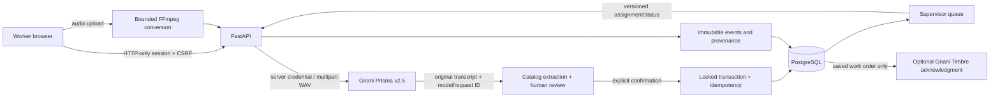

# Architecture and trust boundaries

React/Vite/TypeScript is served from FastAPI at one origin. The browser has no Gnani credential. JWT sessions use HTTP-only SameSite=strict cookies (Secure in production), origin + X-Requested-With CSRF checks, short expiry and current active DB identity/role checks. Explicit bearer tokens support direct API tests; malformed Authorization never falls back to cookies.

Intakes, orders, users, locations, assets, audit events and idempotency records use typed SQLAlchemy models and versioned Alembic migrations. Database constraints and PostgreSQL intake/advisory locks serialize retries and make order/audit/idempotency commits atomic. A unique intake_id remains the final duplicate barrier. Supervisor updates lock the order, require expected_version, enforce allowed transitions and increment the version in the same audit transaction. Raw transcript/model/request ID cannot be changed after they exist. Audit update/delete/truncate and completed-intake delete/truncate are rejected by triggers. Database owners still require administrative discipline; runtime SQL endpoints do not exist.

Audio input is capped before parsing, inspected by file signature, decoded in a random temporary directory with a 20-second subprocess deadline and two decoder slots. FFmpeg is constrained to local file/pipe protocols and at most 31 seconds of mono PCM output. Duration is measured from actual decoded sample count; >30 seconds is rejected. This uses bounded decoding rather than trusting client metadata or requiring a separate ffprobe binary. No long-lived audio attachments are created.

The Gnani adapter has bounded response size/time/retries, no redirect following and no fixture success path. Unknown/missing/empty/truncated response facts never become success. No transcript or credential is logged. A shared provider semaphore and single-process hourly budget cap demo usage; deployment is exactly one worker/replica. A shared persistent limiter would be needed before horizontal scaling.

Timbre returns binary WAV, not JSON. Some genuine streaming WAV responses use placeholder RIFF lengths: canonical_wav validates actual PCM bytes and rewrites the header. Returned TTS model metadata is not invented; evidence distinguishes requested timbre-v2.5 from provider fields actually present.
