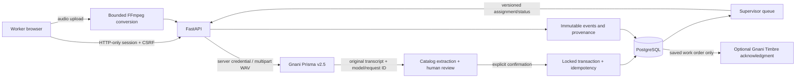

# Architecture and trust boundaries

React/Vite/TypeScript is served from FastAPI at one origin. The browser has no Gnani credential. JWT sessions use HTTP-only SameSite=strict cookies (Secure in production), origin + X-Requested-With CSRF checks, short expiry and current active DB identity/role checks. Explicit bearer tokens support direct API tests; malformed Authorization never falls back to cookies.

Intakes, orders, users, locations, assets, audit events and idempotency records use typed SQLAlchemy models and versioned Alembic migrations. Database constraints and PostgreSQL intake/advisory locks serialize retries and make order/audit/idempotency commits atomic. A unique intake_id remains the final duplicate barrier. Supervisor updates lock the order, require expected_version, enforce allowed transitions and increment the version in the same audit transaction. Raw transcript/model/request ID cannot be changed after they exist. Audit update/delete/truncate and completed-intake delete/truncate are rejected by triggers. Database owners still require administrative discipline; runtime SQL endpoints do not exist.

Audio input is capped before parsing, inspected by file signature, decoded in a random temporary directory with a 20-second subprocess deadline and two decoder slots. FFmpeg is constrained to local file/pipe protocols and at most 31 seconds of mono PCM output. Duration is measured from actual decoded sample count; >30 seconds is rejected. This uses bounded decoding rather than trusting client metadata or requiring a separate ffprobe binary. No long-lived audio attachments are created.

The Gnani adapter has bounded response size/time/retries, no redirect following and no fixture success path. Unknown/missing/empty/truncated response facts never become success. No transcript or credential is logged. The local IMP-05 candidate adds a database-backed rolling operation ledger and retains the shared provider semaphore and single worker/replica. The prior deployed baseline uses process-memory budgets. See [ADR-010](adrs/ADR-010-durable-provider-admission.md) for transactions, retries and the production startup/readiness compatibility gate.

Timbre returns binary WAV, not JSON. Some genuine streaming WAV responses use placeholder RIFF lengths: canonical_wav validates actual PCM bytes and rewrites the header. Returned TTS model metadata is not invented; evidence distinguishes requested timbre-v2.5 from provider fields actually present.

## Operational queue summary — IMP-02

`GET /api/v1/work-orders` retains its list, filtered `total`, page and page size,
and adds a typed `summary`. Both start from `accessible_orders`: workers see their
own reports, judges only explicitly approved reports, supervisors the existing
operational scope. Summary scope is `role_accessible_all`, before search/status/
priority/location/assignee filters and pagination. UI labels are **My reports**,
**Approved sample only** and **All accessible reports** respectively. Filter
results remain separate; no hidden order counts enter a judge or worker summary.

Two bounded aggregate SQL queries calculate status/source/priority/duration counts
and grouped issue counts. Active means OPEN/ASSIGNED/IN_PROGRESS; high priority
uses supervisor-set `Order.priority`, never the worker suggestion. Sources count
one linked intake per saved order, excluding drafts; they measure source mix,
not ASR success. Resolution duration is the arithmetic mean of nonnegative
`resolved_at-created_at` seconds for RESOLVED orders with valid timestamps.
Missing/negative intervals are excluded with a visible valid sample count; no
sample yields null. Status counts sum to total, including cancelled reports.
No deadline/SLA prediction, provider call, raw transcript aggregate or new index
is introduced. Authenticated results remain no-store.

The browser refreshes rows and summary in one response and hides prior metrics
while loading or on an error. It does not fetch every page to calculate totals.
See [synthetic DB tests](../api/tests/integration/test_queue_analytics.py).
